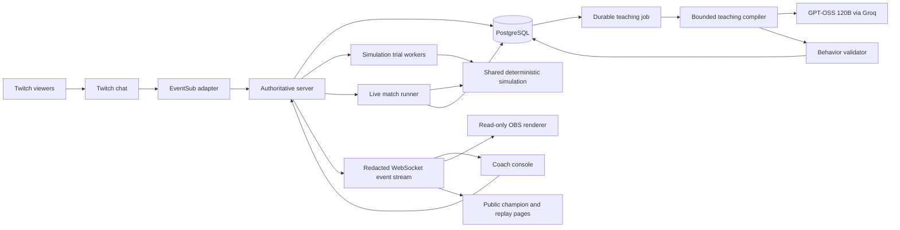

# System architecture

Status: target production architecture. The local build implements `apps/web`, `apps/server`, `packages/contracts`, and `packages/sim`, plus Twitch OAuth, EventSub lifecycle, and a durable local teaching queue. Tokens remain memory-only. It uses local file stores instead of PostgreSQL and a shared Three.js/React Three Fiber scene with an SVG compatibility view; a bounded Groq compiler now handles explicit coach requests. Production services remain pending. See ADR 013–019 in [decisions](decisions.md).

## Architectural principle

**AI proposes lessons; the server proves and publishes them; the engine determines outcomes.** A model never runs inside the match tick. Its availability, latency, or wording cannot change the rules of a running match.

## Stack decisions

| Layer | Choice | Reason |
| --- | --- | --- |
| Runtime / workspace | Node.js 24+, TypeScript, npm workspaces | Shared contracts and simulation; compatible with the current eve prerequisites |
| Web client | React + Vite | Host console, public champion page, and OBS routes in one client |
| Presentation | Three.js via React Three Fiber; semantic HTML controls | Expressive 2.5D arena on top of deterministic logical coordinates |
| Authoritative server | Fastify + WebSocket support | One owner of match state, channel sessions, commands, and subscriptions |
| Teaching worker | One-shot bounded Groq compiler adapter for the local milestone | Strict behavior-data output without tools, automatic loops, or simulation access (ADR 017) |
| Model access | `openai/gpt-oss-120b` on Groq, selected with the owner | Strict JSON output plus stricter local validation; broader evaluation pending |
| Persistence | PostgreSQL; SQL migrations and a typed data adapter | Transactional adoption, idempotency, audit, and job recovery |
| Trial execution | Node worker threads importing the same simulation package | CPU isolation with identical rules; no separate engine implementation |
| Verification | Vitest, Playwright, schema validation, CI | Semantic engine checks and real browser flows |
| Packaging | Docker Compose for local services; containers for a persistent host | Long-lived Twitch connection and server-owned match loop |

Workspace/runtime dependencies are pinned in the lockfile. The AI model ID, hosting vendor/region, and database vendor remain open until an implementation spike confirms availability and measured performance. No exact price or provider limit is assumed. Follow installed eve documentation at scaffold time; this design does not prescribe unverified SDK signatures.

## Component diagram



## Planned repository layout

```text
apps/
  web/                  # React host, spectator, replay, OBS routes
  server/               # Fastify API, sessions, WebSockets, match coordinator
  teacher/              # eve project, instructions, bounded tools, compiler jobs
packages/
  contracts/            # Runtime schemas, DTOs, protocol versions
  sim/                  # Pure tick loop, state, PRNG, rulesets, snapshot codec
  policy/               # Behavior interpreter, validation, conflict analysis
  db/                   # Migrations, repositories, transaction boundaries
  twitch/               # OAuth, validation, EventSub lifecycle, command parser
  ui/                   # Broadcast-safe components and visual tokens
fixtures/
  lessons/              # Supported, ambiguous, adversarial, conflicting lessons
  scenarios/            # Versioned development and holdout manifests
docs/                   # Current specifications and evidence
```

These folders are a plan, not existing application code. Do not create empty packages that imply implemented services.

## Process and deployment model

Initial production shape: one server process owns all admitted matches, a separate teaching worker runs eve, trial workers are bounded children of the server, and PostgreSQL is durable storage. Serve the built web application from the same origin as the API initially to simplify cookies and WebSocket authorization. A TLS reverse proxy provides HTTPS/WSS.

Use a host that supports persistent Node processes, inbound WebSockets, and an outbound EventSub connection. The host is deliberately not chosen by a presumed serverless limitation; verify any selected platform's current capabilities first. A Vercel deployment is an option after evaluating its current realtime/runtime behavior, not a prerequisite.

Start at **two connected channels, one scored match, two trial workers**. These are admission limits for the first deployment, not platform capacity claims. Additional users see a queue or a clear capacity response. Horizontal scaling is deferred; a second active server must not be started without a documented match-ownership lease and pub/sub design.

## Teaching flow

1. An authenticated Twitch event is normalized and deduplicated in a transaction.
2. Only an explicit `!teach` command creates a proposal; ordinary chat is not persisted or sent to a model.
3. The server stores author/channel provenance and queues a job with a schema version and base playbook hash.
4. A leased worker sends bounded lesson text and public mechanic definitions to the teaching agent. It does not receive tokens, arbitrary chat history, database credentials, or private rival playbooks.
5. The agent returns a bounded candidate or an unsupported/clarification result. A deterministic validator checks facts, limits, supported goals, and resource use.
6. The candidate is persisted; trial workers evaluate its overlay on the base version.
7. The coach reviews evidence and adopts using an expected version. Publication is a server-owned transaction.

The teacher cannot call the adoption endpoint. Its tool surface can read supported mechanics, validate a candidate, and return a result. No shell, general browser, external messaging, unrestricted filesystem, or arbitrary code tools are needed.

## Match and replay flow

At match start, pin both policy versions, arena/ruleset version, engine version, and seed. One scheduler advances the logical clock. Publish interpolatable snapshots and decision receipts; do not ask clients to calculate score. The server persists inputs and periodic full checkpoints. Trials use exact snapshot restoration and the same `sim`/`policy` packages.

Renderer frame rate is independent from simulation tick rate. Worker overload may slow a trial queue, but cannot mutate a scored match. If the server cannot keep the match within its scheduling budget, pause with an explicit reason rather than silently skipping ticks.

## Persistence and recovery

- Write proposals, job transitions, adoptions, and their outbox events transactionally.
- Jobs have a lease, attempt counter, deadline, and idempotent completion key. Expired leases can be reclaimed; completed results cannot be published twice.
- Checkpoint scored matches every 20 ticks and persist external commands in order. On restart, mark the match paused, restore the last complete checkpoint, and replay durable commands to the durable tick watermark.
- Do not resume silently after a crash. The coach can resume from the recovered tick or void/rematch. A displayed live tick beyond the durable watermark may be rolled back; show that fact explicitly.
- A checkpoint contains complete state and hashes. If engine/ruleset versions are unavailable or hashes fail, keep the match paused and report an unsupported replay.
- Twitch disconnects do not erase stored proposals. Events missed during an EventSub gap are not recoverable by assumption; see [Twitch integration](twitch-integration.md).

## Isolation and security boundaries

Coach commands require an authenticated authorized session. Public/OBS routes expose redacted state only. OAuth credentials are encrypted at rest with a deployment secret outside the database. Database access is server-side; there is no public client database key.

Never trust channel IDs, contributor IDs, job status, policy ownership, or model-supplied provenance from a client request. Derive them from the authenticated session/event and stored relationships. An opaque overlay key is read-only and rotatable; it is not a coach credential.

## Observability and budgets

Correlate `proposalId`, `compileJobId`, `trialId`, `playbookVersionId`, `matchId`, and `decisionId` across structured logs. Record compile latency, schema rejection, queued age, trial duration, tick scheduling lag, socket lag, reconnections, and model token usage. Exclude secrets and ordinary chat text.

Proposed targets: command receipt to queued UI under 1 second p95; compiler result under 10 seconds p95; one two-branch 60-second simulated trial under 2 seconds p95 at admitted capacity; render at least 30 FPS on the declared OBS reference machine. These require measurement and may be revised transparently.

Set explicit operator-configured daily model spend and per-channel compile quotas before live usage. Track reserved and actual usage; reject new jobs visibly at the cap. No automatic paid-resource provisioning. Offline fixture mode must require no model or Twitch credentials and must label all simulated integrations.

## Implementation spike requirements

Confirm eve supports the bounded structured-output job contract and local container startup; inspect its installed docs. Run a real authorization/EventSub spike in parallel with the first deterministic arena implementation where task dependencies allow. If a selected SDK cannot satisfy the contract, record an ADR before changing the adapter; the simulation and policy format must remain independent of it.

References: [eve prerequisites and initialization](https://eve.dev/docs/getting-started), [OpenAI structured outputs](https://developers.openai.com/api/docs/guides/structured-outputs). See [sources](sources.md) for integration references and verification dates.

## Local compiler implementation (ADR 017)

The current Fastify coordinator invokes `apps/server/src/compiler.ts` on explicit coach request,
outside the tick. A durable proposal stores the attempt, base playbook hash/version, model ID,
prompt hash and validated outcome. One HTTP request has no tools, retrieval, shell, or generated
code execution. Groq's wire schema uses a flat condition object because its constrained decoder
rejects overlapping fact/operator unions; the full typed local schema is mandatory after decoding.
Source eligibility is checked for replay and adoption. Local source operations serialize with
moderation while the adopted playbook is saved. Cross-file crash recovery, SQL transactions,
job leases and distributed budgets are still production work. Eve is deferred, not installed.

## Local game presentation (ADR 018)

`apps/web/src/game` projects immutable world snapshots through a fixed orthographic camera.
The same scene is lazy-loaded by the coach, replay branches and read-only overlay. No physics,
path planning, collision, random game decisions or AI calls occur in rendering. Pure presentation
helpers bound interpolation and reject discontinuous snapshots; the server simulation stays
unchanged. State-derived event age controls visual effects. An opt-in Web Audio hook admits only
new events from consecutive running snapshots, excluding seek/reconnect playback.

Champion meshes are merged by animated joint with vertex colors; scenery uses instanced meshes.
Paused and reduced-motion scenes render on demand, replay uses low effects, and the covered
coach scene unmounts while its replay dialog is open. Low effects caps DPR and disables shadows.
Resources dispose on unmount. WebGL errors/context loss select the labeled SVG compatibility
view, without resetting the world. UI preferences are browser-local presentation state and never
sent as simulation commands. The scene chunk is separate from the primary studio bundle.

## Combat study and trace patch

`core-run/0.1.1` emits legal `strike` contacts with attacker/target, positions and post-shield
attack damage. Gameplay rules remain unchanged; complete earlier-version snapshots are rejected
because the event trace/hash changes. Local stored playbooks are compatible.

The loopback `GET /api/demo/combat-study` lazily generates one fixed, non-user scenario in a
bounded Node worker, shares pending/completed results, resets a failed job for explicit retry,
and uses the existing two-worker pool/close cleanup. The twelve-second result contains full
frames, contacts and source/final hashes; it never reads or changes a user's studio. No model,
Twitch or arbitrary scenario input is involved. `/combat-lab` samples known replay contacts for
pure deterministic choreography, with a separate lazy 3D scene and SVG compatibility rendering.
See [Combat Lab](combat-direction.md) for timing and the future live-animation boundary.

### Shared acrobatic fighter rollout

The shared arena now uses the same articulated `FighterRig` as Combat Lab. Its pose sampler
reads the current `World`, observed movement and only past/current strike records. Combat Lab
retains its separate complete-replay sampler. Match/replay poses never look ahead or feed back
into the engine. Subframe pose time is bounded to two ticks; paused snapshots sample exactly.
Animation enablement is separate from accessibility reduction so paused branch contacts retain
their chosen pose. SVG fallback and portraits use an original matching `FighterGlyph`.
