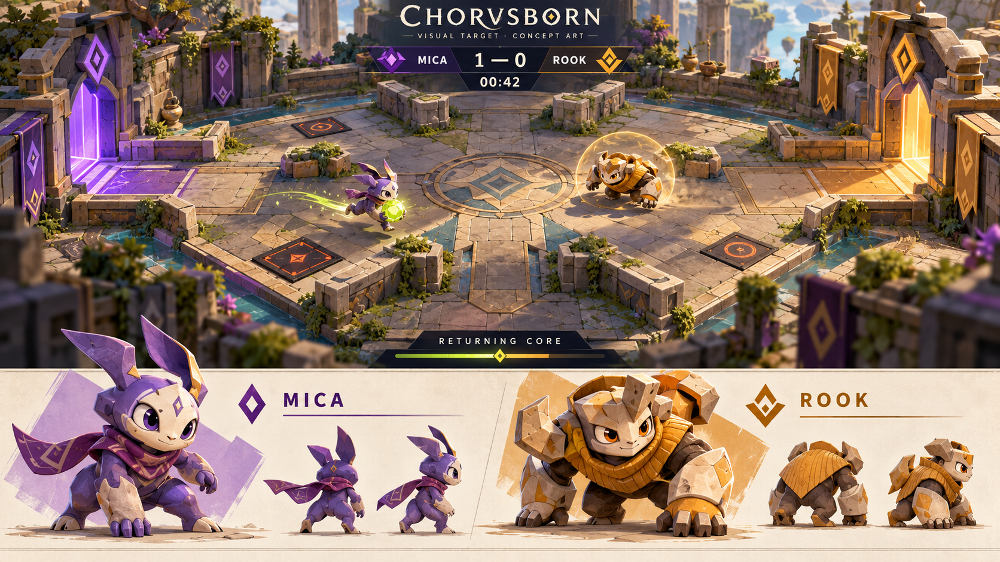

# Core Run: visual identity and game feel

Status: **first playable 3D slice implemented, October 27, 2026**. Training, both replay
branches and the read-only overlay share a Three.js/React Three Fiber scene. Original
procedural Mica/Rook rigs, modular garden scenery, state-driven cues, optional sound,
reduced motion and a WebGL compatibility view are implemented. The concept below remains
the visual target; these first geometry-built characters are not final sculpted production assets.

[Generation record and exact prompt](concepts/core-run-direction-v1.prompt.md).

## Creative premise

Make Chorusborn feel like a spectator sport populated by creatures a community wants to raise.
The game needs personality in its characters, physicality in its world, and visible consequences
when a lesson changes a decision. Arena art, movement, sound and broadcast framing work together;
a new color palette alone will not establish that identity.

Direction: a warm, stylized **2.5D relay arena**, built from tactile stone and ceramic, with
moss and foliage at its edges. Worn lanes and distinctive home gates communicate a place with
purpose. Controlled violet, amber and lime accents carry team and objective information against
calmer materials. Preserve the existing brand's warmth and competition.

Working venue name: **Relay Garden**. This is an environmental art theme, not a new ruleset.
Water, distant structures and plants in the concept are decorative aspirations. They must not
suggest traversable ground, damage, healing or routes absent from authoritative game state.

## Names and character identity

Keep **Chorusborn** as the game and **Core Run** as the sport. Retain **Mica** and **Rook** as
working champion names; the current names have useful material and competitive associations.
They need recognizable visual identities and performance rather than another naming exercise.
Future community naming/customization is still a product feature to implement.

| Champion | Silhouette and materials | Personality expressed through animation | Competitive constraint |
| --- | --- | --- | --- |
| Mica | Light face mask, tall asymmetric fins, compact violet ceramic body, short trailing scarf | Curious head tilts, eager forward anticipation, proud core-carry pose, quick recovery from a stumble | Same legal movement, health and collision footprint as Rook |
| Rook | Broad angular brow, low shoulder shapes, amber stone plates and ribbed mantle | Deliberate stance, confident shoulder roll, guarded core-carry pose, compact victory stomp | A heavier appearance must not imply hidden armor or slower movement |

The concept establishes silhouette and material direction. Production turnarounds must reconcile
fin/horn placement, limb proportions, front/back appearance and accessories across all views.
Keep face/eye detail readable at the game's actual camera scale. Avoid reproducing an identifiable
character or costume from another game. Cosmetics must not disguise the core, shield or team.

## What viewers see

The broadcast composition is predominantly arena. A compact scoreboard carries champion/team
names, captures, timer and match mode. Health and possession sit close to the relevant champion.
Home gates use different shapes/patterns in addition to color. Show one short intent or real
contribution cue at a time. The scene must make the core carrier and destination obvious even
without reading chat.

The coach console is a separate working surface: large playable preview, focused lesson tray,
then review/prove/adopt controls. The host can reveal deeper evidence deliberately. Connection
setup, provider names and token counters stay in the private operational surface.

Use the same game renderer in training, live arena, overlay and both replay branches. A dedicated
read-only broadcast comparison scene is part of the presentation work; the existing overlay
shows the world only; a broadcast comparison route remains pending. Avoid capturing the full administrative console as the default
viewer experience.

## Animation and effect language

| State or event | Proposed visible treatment | Source of truth |
| --- | --- | --- |
| Idle | Breathing, slight ear/fin movement, a restrained glance | Cosmetic clock only; cannot imply a new tactical observation |
| Running | Facing direction, stride, body lean, scarf follow-through; smooth movement between received positions | Authoritative positions/ticks; no renderer-driven pathfinding |
| Core pickup/carry | Clear lift/carry pose, core glow and short possession trail | Core carrier and pickup event |
| Tag hit | Brief contact flash, recoil pose and a restrained impact sound | Actual damage/event-derived state; no invented hit or damage |
| Shield | A legible shell around the champion with a distinct expiry cue | `shieldUntil` and current server tick |
| Decoy | Translucent echo with a distinct outline/label | Actual decoy entity and expiry |
| Hazard | Ground telegraph and active pulse, with unchanged legal boundaries | Existing deterministic hazard phase |
| Capture | Gate response, short character celebration, score transition, optional restrained camera impulse | Capture event keyed by match/tick/actor; reconnect cannot replay old celebrations as new |
| Defeat/respawn | Brief collapse/dissolve and clear reformation at home | Health/respawn state; no additional game delay |
| Lesson execution | One bounded "Lesson used · author" cue | Actual executed decision record; never a synthetic claim of causing a win |

Audio adds pickup, shield, contact, capture and result cues. Use created or properly licensed
sound, keep it optional, and support mute/reduced motion. Camera shake, flashing and particles
need reduced-motion controls. No essential information should depend on sound or team color.

## Renderer approach

Implement a fixed elevated camera with stylized 3D assets and lighting, using the presentation
stack already contemplated in the architecture (Three.js/React Three Fiber), subject to a real
integration and frame-time check. Use semantic HTML for controls and outcome summaries. The
server's integer grid and simulation remain authoritative; this is a rendering upgrade, not
3D physics or a rewrite of game rules.

Use reusable arena modules, two coherent character rigs, limited lights, cached materials and
bounded effects. Camera framing must show the complete legal arena without hiding champions
behind decorative foreground walls. If depth requires occluders, fade them without changing
collision. The image is a reference for materials/composition, not a texture to stretch across
the arena and call live 3D. Score, timer, intent, source attribution and HUD text must be drawn
from application state, not baked into generated imagery.

The concept's decorative bottom bar does not introduce a new energy/progress mechanic. Rebuild
the wordmark and all UI text in code with correct "Chorusborn" spelling; generated lettering is
not the final logo. The lower character-design strip belongs to this concept board, not the
live match screen.

## Build sequence and review gates

1. **Character kit:** consistent Mica/Rook turnarounds, runtime-ready models/materials, neutral
   stance and a small shared animation vocabulary. Test silhouettes at actual broadcast size.
2. **Playable visual slice:** map one exact legal arena to modular scenery, place both champions,
   smooth rendering of server positions, readable core/home gates, health and score. Training,
   replay and OBS use the same renderer.
3. **Game feel:** bind pickup/carry/shield/decoy/hazard/capture/defeat cues to actual state/events.
   Add small expressive animations, optional audio and reduced motion. Replays and reconnects
   must handle effects correctly.
4. **Broadcast direction:** focused score/time strip, a readable contribution cue, optional
   webcam-safe layout, replay comparison scene and result/rematch presentation.
5. **Finish and validate:** measure frame time with OBS and both replay views; inspect compressed
   720p output, keyboard interaction, contrast, team distinction and reduced motion. Then extend
   the kit to the other authored layouts and community customization.

Targets, not measurements: smooth 60 fps on the agreed reference machine, a usable lower-effects
mode under OBS, clear action at 720p, and a complete arena view at 1080p. Record actual hardware,
frame-time results and viewer feedback before claiming performance or readability.

A useful visual slice must pass these checks: viewers can point out the core carrier and its
home gate; distinguish the two champions without names/colors alone; recognize a shield and
capture; and explain one actual lesson-use cue. Preserve deterministic state hashes and the
existing teach/prove/adopt checks while changing rendering.

## Delivery boundary

This is an original proposed style, not a promise that the generated image is already a playable
scene or that every decorative detail should ship. The next presentation increment should
produce one coherent game scene with recognizable characters and verified interactions before
expanding the scenery inventory. Functional release work—evaluation, persistence and rivalry—
continues to be required alongside presentation.

## Implemented slice and remaining finish

- Original geometry-built Mica and Rook have separate silhouettes, masks/eyes, fins or horns,
  scarf or mantle, stride, breathing, carry posture, damage recoil and defeat/capture poses.
  These are shared procedural rigs, not imported franchise assets or the concept stretched
  across the playfield. Portraits are original code-native SVGs.
- Instanced stone paving, legal walls, edge foliage, shaped home pads/monuments and hazard
  runes follow the existing arena dimensions. The actual capture pad is distinct from its
  decorative gate; foliage/monuments sit outside legal routes.
- Health, possession, shield, decoy and lesson-use cues use server snapshots. Interpolation
  is bounded between adjacent received states; resets, seeks, captures and respawns snap.
  Replays use the same renderer with synchronized existing timeline controls.
- Web Audio pickup, shield, decoy, defeat and capture cues are synthesized locally, muted
  initially and enabled by a click. Mounting, seeking and reconnect gaps do not replay old
  sounds. Coach preview audio is optional; overlay/replay views stay silent in this slice.
  No downloaded audio assets or model requests are used by rendering.
- Low effects removes shadow rendering and caps pixel density at one; mobile defaults to it.
  Paused/reduced-motion scenes render on demand. The covered live canvas unmounts while the
  replay dialog is open. Missing/lost WebGL falls back to the original labeled SVG view.
- Static pieces are baked into one vertex-colored mesh per moving rig part; terrain is
  instanced. The Three.js scene loads as a separate lazy chunk. Current bundle size and
  small local frame samples are diagnostic evidence, not the planned OBS acceptance gate.

Remaining: sculpted character turnarounds/material refinement, richer venue dressing, polished
result/rematch direction, broadcast replay scene, viewer playtests, compressed-720p readability
and sustained frame-time measurements with OBS on a named reference machine. No 60-fps claim
is established by this milestone. Functional release requirements remain in [scope](scope.md).
