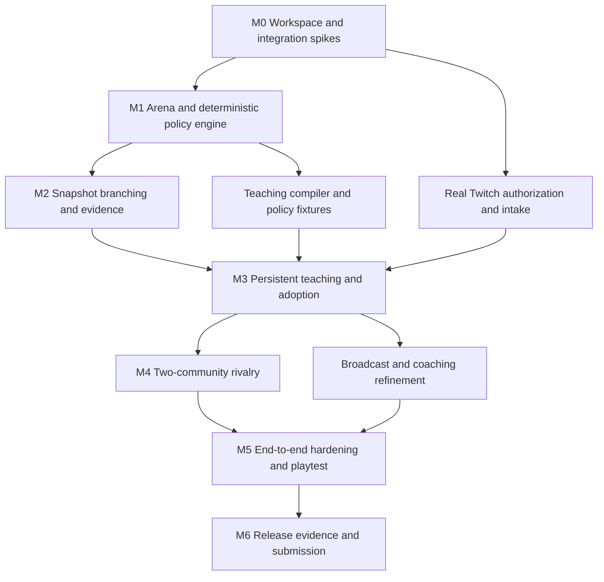

# Full delivery plan

Baseline: October 26, 2026, Africa/Nairobi. Target: a release candidate within five build days, followed by external playtesting, recording, and submission buffer. This is an aggressive execution target, not a claim that implementation is complete or an excuse to remove the central experience.

## Dependency graph

Independent work can overlap when tools and task context permit; dependencies must still be verified in order. No subagents have been created for the planning baseline. Delegate only when the owner or applicable instructions authorize it.

## Milestones

| Milestone | Build outcome | Exit condition | Suggested commit boundary |
| --- | --- | --- | --- |
| M0 | Actual workspace, local DB, contracts, agent/connection feasibility | Reproducible fixture startup; minimal real Twitch event; bounded eve candidate output | `chore: scaffold workspace and local runtime` |
| M1 | Complete Core Run with baseline policies | Legal round resolves, deterministic state hashes, browser renderer follows server | `feat(sim): deliver deterministic core run` |
| M2 | Exact branching replay and truthful evidence | Saved state restores twice; only tested policy differs; negative trials remain visible | `feat(replay): compare policy branches` |
| M3 | Persistent teach/prove/adopt loop | Real chat lesson compiles, is tested, adopted at next round, survives restart, credits trace to actions | Several focused teaching/storage/Twitch commits |
| M4 | Rival communities | Two real channel owners consent and enter one match with pinned versions and equal rules | `feat(rivalry): connect community champions` |
| M5 | Broadcast quality and recovery | Role boundaries, quotas, crash/reconnect behavior, readable OBS composition, playtest findings addressed | Focused hardening and presentation commits |
| M6 | Submission-ready release | Quality gates, clean-machine instructions, final demo, genuine Codex evidence, accessible repo | `docs: finalize verified release and judging guide` |

## Five-day target

| Date | Primary target | Secondary work / evidence |
| --- | --- | --- |
| Oct 26 — day 1 | Planning baseline, M0, first legal arena loop | Confirm two channel participants and developer app; begin model-contract spike |
| Oct 27 — day 2 | M1 and M2 | First saved failure and deterministic branch proof; basic OBS route |
| Oct 28 — day 3 | M3 | Real viewer lesson through adoption; persistence and execution-backed credit |
| Oct 29 — day 4 | M4 | Two-channel challenge/accept/match; coaching and broadcast refinement |
| Oct 30 — day 5 | M5 and release candidate | Quality gates, reference-machine measurements, independent playtest if available |
| Oct 31–Nov 1 | M6 | Fix observed issues, record under-three-minute video, prepare verified submission |
| Nov 2 | Submission buffer | Upload/access checks and final submission well before deadline |

Deadline: Nov 3 at 01:00 Nairobi, equivalent to Nov 2 at 14:00 PST. Confirm the live deadline before submitting. Planning sessions can accelerate coding, but external account access, real viewers, and verified results remain explicit dependencies.

## Ordered implementation backlog

Progress: B01 and B03 are implemented locally. Initial B07–B13 foundations exist, including an integer arena, policy interpreter, authoritative server, SVG presentation, complete-state checkpoint comparison and trial workers. They are not equivalent to finished production milestones: PostgreSQL, real Twitch intake, the language compiler, full scenario evaluation, and two-channel rivalry remain outstanding. See [build log](build-log.md) for exact checks; all other work is pending unless that log says otherwise.

| ID | Task | Depends on | Done when |
| --- | --- | --- | --- |
| B01 | Pin Node/npm, scaffold workspaces and actual package scripts | Baseline | Fresh install and one real build/check command work |
| B02 | Add local Postgres, migrations, runtime configuration examples | B01 | DB can migrate from empty and restart without data loss |
| B03 | Implement runtime schemas and candidate validation | B01 | Example candidate passes; wrong facts/types/limits fail |
| B04 | Scaffold bounded eve worker; evaluate allowed tool configuration | B01, B03 | One real structured candidate; no unauthorized tool surface; SDK docs pinned |
| B05 | Register/configure Twitch app and broadcaster OAuth flow | B01, owner account access | Verified token maps to the connecting owner; scopes/state checked |
| B06 | Build EventSub lifecycle and ingress adapter | B02, B05 | Actual `!teach` is received once; duplicate/revoke/gap handled |
| B07 | Implement pure state, fixed clock, seed, integer movement/pathing | B01, B03 | Stable per-tick hashes and path tie tests pass |
| B08 | Implement core/attack/shield/decoy/hazard/respawn/end rules | B07 | Entire round resolves and simultaneous-edge cases pass |
| B09 | Implement baseline and learned policy interpreter | B03, B08 | Typed goals, legality, priorities, fallback and receipts work |
| B10 | Add server-owned runner and redacted realtime snapshots | B02, B08, B09 | Client refresh/reconnect reproduces authoritative score |
| B11 | Build readable arena renderer and initial host controls | B10 | Full round visible and keyboard controls usable |
| B12 | Implement complete snapshot codec and compatibility checks | B07–B10 | Restore matches uninterrupted execution; bad versions fail |
| B13 | Add two-branch trial workers and shared replay timeline | B12 | Baseline/candidate state hashes and reactive opponent preserved |
| B14 | Author/freeze scenario suite and metric aggregation | B13 | All declared development/holdout scenarios reported separately |
| B15 | Create compiler corpus, prompt, model bake-off and budget caps | B03, B04, B09 | Versioned report; unsupported inputs handled; chosen model pinned |
| B16 | Add proposal queue, moderation, vote shortlisting and job leases | B02, B06, B15 | Bounded intake, fair votes, reclaimable job, idempotent completion |
| B17 | Implement immutable playbooks, adoption CAS and rollback | B02, B09, B13, B14, B16 | Concurrent stale writes rejected; running match unchanged |
| B18 | Connect lesson UI, evidence, adoption and contribution ledger | B11, B13, B16, B17 | Real viewer completes teach/prove/adopt/use loop |
| B19 | Add authenticated challenge/accept and pinned two-channel match | B06, B10, B17 | Both owners consent; each overlay agrees on result |
| B20 | Add coach/reviewer/public authorization and attribution removal | B05, B16–B19 | Negative role/cross-channel tests pass; credit can be hidden |
| B21 | Add checkpoint/outbox recovery and degraded-state UX | B10, B12, B16, B17 | Restart restores acknowledged state; pause/reconnect visible |
| B22 | Finish broadcast visual system, cosmetics, audio/reduced motion | B11, B18, B19 | OBS reference composition readable and performance measured |
| B23 | Add CI and clean-machine fixture/live setup documentation | B01, B02, B18 | Fresh clone runs fixtures with no external credentials |
| B24 | Run real-channel end-to-end and independent playtest | B18–B23 | Findings/evidence recorded; all critical failures resolved |
| B25 | Produce verified Devpost copy, demo video and Codex evidence | B24 | Artifacts reflect the actual release; session ID verified |
| B26 | Publish authorized remote/deployment and submit | B25, owner publishing instructions | Repo access/video availability/deployment checked; entry submitted |

Ranges in dependencies mean every task in that range. Work on authorization patterns starts with B05/B10; B20 completes the adversarial verification and contributor controls rather than adding security at the end.

## What to do first when implementation starts

Deliver one vertical technical slice: fixed arena state → baseline policy → one hardcoded valid lesson candidate → exact two-branch comparison. In parallel where feasible, prove a real Twitch event and a bounded eve result. Then replace the candidate fixture with real teaching. This order tests the hardest product promise before extensive cosmetic work; it does not replace the required live integration.

## External dependencies and unresolved inputs

| Dependency | Needed by | Current status |
| --- | --- | --- |
| Twitch developer application and approved redirect configuration | B05 | Not created/verified |
| First broadcaster account and cooperating rival broadcaster | B06 / B19 / B24 | First channel: developersimiyu; rival not yet identified |
| Runtime model access and explicit spend cap | B04 / B15 | Not configured |
| Deployment host/DB choice and hosting budget | B21 / B26 | Not selected or provisioned |
| Public repository destination or private judging access | B26 | Connected to https://github.com/simiyu-samuel/chorusborn.git; judging access still to confirm |
| Final license/asset rights and video participant consent | B22 / B25 | Pending |
| Main build-thread Codex session ID | B25 | Must be verified through Codex; never guessed |

These do not block the current documentation/Git task. Request the specific input when dependent implementation needs it, while continuing independent local work.

## Change discipline

Keep acceptance IDs stable. Record any scope change with its rationale and effect on the demo. If a milestone slips, address bottlenecks and optional content first; do not silently replace deterministic proof with an animation or two real channels with a simulated second audience. Report remaining work explicitly. Commit each coherent finished increment and keep the build log current.
