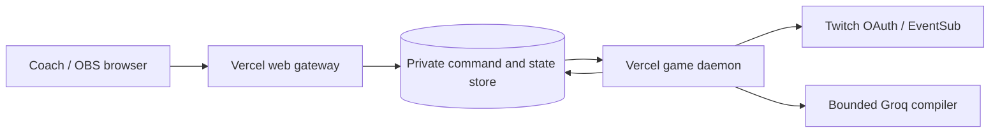

# Vercel deployment design

Status: deployed to Vercel production on October 29, 2026 at
[chorusborn.vercel.app](https://chorusborn.vercel.app). Public health, guide, sample
proof/adoption, live round/overlay and real developersimiyu OAuth/EventSub connection
have been observed. A fresh hosted viewer lesson and independent remote rivalry
demonstration remain pending.

## One authority, distributed ingress

Keep all application compute on Vercel. Serve the Vite build at the public origin;
route API and OAuth requests through a gateway. Run the existing authoritative
Fastify application in a Vercel Daemon rather than independently in every web
function instance. Daemons are currently a public beta and production-only.

Use a private, durable coordination store provisioned through Vercel Marketplace.
Redis fits the required lease, command queue, response expiry and stream fan-out.
The provisioned resource is Upstash Redis `chorusborn-state`, Free plan in `iad1`,
with automatic upgrades and eviction disabled. The daemon and gateways use TLS Redis
TCP through pinned ioredis 6.0.0 for blocking dequeue and pub/sub; browser code never
connects to Redis. Provider SDK guidance was read before implementation.



The daemon consumes commands and owns the 20 Hz simulation. Gateway instances
relay authenticated commands and stream redacted snapshots; they never simulate
independent copies of a match. Do not depend on request affinity, process-local
sessions in the gateway, or a container's ephemeral filesystem.

## Required boundaries

- A renewable, fenced authority lease prevents overlapping old/new daemon
  deployments from publishing conflicting state. Loss of lease stops processing
  and publication; stale writers cannot persist or acknowledge a command.
- Commands carry unique IDs, expiry and bounded request payloads. Store durable
  completion receipts so duplicate delivery cannot repeat adoption, core control,
  compilation or OAuth code exchange. Expired commands fail explicitly.
- Persist channel books, proposal queues, ingress deduplication and checkpointed
  match state outside the daemon. A restart restores the last durable checkpoint
  in a paused state; both coaches explicitly resume. Never manufacture elapsed
  simulation ticks during an outage.
- Protect coach cookies with HttpOnly, Secure and SameSite=Lax. Trust only the
  explicitly configured HTTPS origin for browser mutations, OAuth redirects and
  WebSocket upgrades. Preview deployments must not mutate production state.
- Keep Twitch refresh/access tokens server-only and encrypted at rest, with a
  separate deployment secret. Pending OAuth state must remain one-use and bound
  to the initiating studio. Revalidate recovered Twitch authority before use.
- Retain read-only overlay keys and redacted payloads. Do not put credentials,
  private source joins or coach queues into public snapshot channels.
- Bound studio admission, compiler requests, replay workers and gateway queues.
  Report unavailable infrastructure as unavailable rather than silently falling
  back to an isolated fixture that looks like the live rivalry.

## Implemented runtime and limits

- `apps/server/src/cloud/gateway.ts` serves the Vite build, forwards bounded HTTP
  requests and authorizes read-only coach/overlay streams before Redis subscription.
  It only accepts the configured production origin. Stream reconnects refresh state;
  old initial snapshots are not sent after a newer streamed packet.
- `authority.ts` runs the existing game application under one renewable 15-second
  lease. Every checkpoint, acknowledgement and publication checks that lease in
  Redis Lua. Overlapping daemons wait rather than run independent matches.
- Commands are encrypted, expire after 35 seconds and have durable started/completed
  receipts. A checkpoint and successful response commit in one fenced Redis script.
  A duplicate returns its prior response; an interrupted attempt returns an explicit
  conflict. External provider side effects are not claimed to be transactional with
  Redis. Ambiguous attempts are never automatically re-executed.
- AES-256-GCM with a production-only key protects requests, responses, streams and
  gzip-compressed checkpoints. Authentication binds each envelope to its namespace
  and purpose. The checkpoint contains canonical books, queues/deduplication,
  pending OAuth/session data, arenas, trials, invitations and shared matches.
- The daemon checkpoints dirty state approximately once a second while no HTTP
  command is active, and commits after each command. An abrupt failure may lose
  uncommitted ticks or a recent inbound chat event; recovery resumes from the last
  durable checkpoint, pauses running worlds, clears readiness, marks interrupted
  compilations failed and revalidates Twitch sessions. No offline ticks are invented.
- Cloud compiler calls are reserved durably before the model request, with a hard
  budget of 20 until the owner reviews usage. The gateway queue admits at most 100
  requests, each instance at most 30 waiting RPCs. Cloud studios are bounded at 50;
  anonymous demos expire after 20 minutes without an HTTP interaction when new
  visitors arrive. Verified channel books are retained. Chat remains bounded at
  20 channels and replay workers at two. This is a bounded hackathon prototype,
  not a demonstrated large-audience deployment.
- The root Dockerfile builds one source version for the gateway service and arena
  daemon. Docker/Vercel ignore files exclude credentials, local stores, recordings,
  generated output and dependencies. Production secrets are never `VITE_` variables;
  preview deployments are denied access to the production authority.

## Verification before publishing the live link

1. Provision the intended project and store in the SamuelDevKe Vercel team.
2. Exercise two gateway instances against one authority and durable store.
3. Check duplicate commands, lost leases, overlapping deployments and restart
   recovery, including a persisted adoption and a paused shared match.
4. Verify HTTPS OAuth with the registered production callback, chat intake,
   two independently authenticated channels and spectator isolation.
5. Verify guide and deep links, arena/replay rendering and reconnect behavior at
   the production URL before adding it to Devpost as a working application.

Current local sessions and playbooks are private development data; deployment
must not upload them or the ignored local credential file as source assets.

## Official references

- [Vercel Daemons](https://vercel.com/docs/daemons): continuous workers; beta,
  production-only, ephemeral container storage.
- [Vercel WebSockets](https://vercel.com/docs/functions/websockets): connections
  may reconnect to a different instance; durable state/coordination is external.
- [Container runtime](https://vercel.com/docs/functions/runtimes/container):
  containers scale down; a container image alone does not provide one durable
  match authority.

## Provisioned target and reproducible checks

Project: `samueldevke/chorusborn`, ID `prj_65W8NVdJhsZ6b75Jbrv3MPQHK8GT`.
Vercel assigned `chorusborn.vercel.app`; it returned public health/guide responses and the in-app browser connected to its engine.
The configured callback is `https://chorusborn.vercel.app/auth/twitch/callback` and
was registered in the Twitch developer console by the owner before hosted sign-in succeeded.

Normal `npm run check` uses no external service. Explicit opt-in checks are:

```sh
node --import tsx apps/server/scripts/cloud-smoke.ts
node --import tsx apps/server/scripts/cloud-rivalry-smoke.ts
```

They read the ignored `.env.vercel.local` storage credentials and each create a
fresh random `chorusborn:*smoke:*` namespace with a new temporary encryption key.
They never use the production authority namespace or real Twitch/model credentials.
They clean only their own temporary keys. The first checks independent gateways,
proof/adoption, duplicate receipts, spectator denial and stale-writer fencing; the
second uses mocked providers to check two-channel teaching, shared rivalry,
WebSocket delivery and revalidated encrypted recovery.
